<div align="center">

# ✈️ Airline Tweet Sentiment Analysis

### Natural Language Processing· Airline Tweet Analytics from Raw Text to Streamlit App


**An end-to-end Natural Language Processing project using Python,
Jupyter Notebook, Scikit-learn, Word2Vec, NLTK, TextBlob, and
Streamlit.**


</div>

------------------------------------------------------------------------

## 📌 Project at a Glance

  -----------------------------------------------------------------------
  Item                                Details
  ----------------------------------- -----------------------------------
  Project                             Airline Tweet Sentiment Analysis

  Practical                           NLP Practical Exam --- Set B

  Dataset                             `Tweets.csv`

  Original dataset size               14,640 tweets

  Selected columns                    `airline`, `airline_sentiment`,
                                      `negativereason`, `text`

  Sentiment classes                   Negative, Neutral, Positive

  Main classification model           Logistic Regression

  Best feature method                 TF-IDF with Unigrams and Bigrams

  Best Step 4 macro F1-score          0.7164

  Application                         Streamlit Sentiment Analysis Studio
  -----------------------------------------------------------------------

> **Results note:** Numerical results below are taken from the uploaded
> notebook outputs where available. The majority-baseline and
> classification-report issues found in the notebook are called out in
> the evaluation notes rather than silently presented as correct
> results.

## 🎯 Project Objectives

-   Explore airline customer tweets and understand the sentiment
    distribution.
-   Extract mentions, hashtags, URLs, and flight numbers using Regular
    Expressions.
-   Clean and preprocess tweet text for Natural Language Processing.
-   Compare stemming and lemmatization.
-   Build text features using Bag of Words, TF-IDF, and N-Grams.
-   Train CBOW and Skip-gram Word2Vec embeddings.
-   Compare multiple machine learning classifiers using suitable
    evaluation metrics.
-   Compare heuristic, TextBlob, and machine learning sentiment
    approaches.
-   Use NLTK Part-of-Speech tagging to identify common nouns in negative
    tweets.
-   Build an interactive Streamlit application for customer tweet
    analysis.

## 🗂️ Practical Overview

  -----------------------------------------------------------------------
  Step                    Practical               Main Concepts
  ----------------------- ----------------------- -----------------------
  **1**                   Dataset Exploration,    Dataset inspection,
                          RegEx and Text          sentiment distribution,
                          Preprocessing           mentions, hashtags, URL
                                                  extraction, cleaning,
                                                  stop words, stemming,
                                                  lemmatization, word
                                                  frequency

  **2**                   Feature Extraction      Bag of Words, TF-IDF,
                                                  unigrams, bigrams,
                                                  sparsity, feature
                                                  comparison

  **3**                   Word Embeddings         Word2Vec, CBOW,
                                                  Skip-gram, word
                                                  similarity, PCA
                                                  visualisation

  **4**                   Text Classification     Train-test split,
                          Pipeline                majority baseline,
                                                  Logistic Regression,
                                                  macro precision, macro
                                                  recall, macro F1,
                                                  confusion matrix, model
                                                  saving

  **5**                   Sentiment Approaches    Heuristic sentiment,
                          and POS Tagging         TextBlob, ML
                                                  comparison, NLTK
                                                  tokenization, POS tags,
                                                  noun frequency

  **6**                   Streamlit Application   Saved model
                                                  integration, sentiment
                                                  prediction, probability
                                                  display, tweet
                                                  insights, POS tagging
                                                  interface
  -----------------------------------------------------------------------

------------------------------------------------------------------------

# 🧪 Step-by-Step Practicals

## Step 1 --- Dataset Exploration, RegEx and Text Preprocessing

### Objective

Explore airline customer feedback, identify sentiment patterns, and
prepare tweet text for feature extraction and classification.

### Workflow

1.  Load `Tweets.csv` using Pandas.
2.  Select the four required columns: `airline`, `airline_sentiment`,
    `negativereason`, and `text`.
3.  Inspect dataset shape, data types, missing values, and sentiment
    counts.
4.  Analyse sentiment distribution across airlines.
5.  Calculate the percentage of negative tweets for each airline.
6.  Extract `@mentions`, hashtags, URLs, and flight-number patterns
    using RegEx.
7.  Replace mentions and URLs with placeholder text for inspection.
8.  Build a `clean_text()` preprocessing function.
9.  Remove unnecessary text elements and stop words while preserving
    negation words such as `not`, `no`, and `nor`.
10. Compare stemming and lemmatization.
11. Identify the most frequent words in positive and negative tweets.

### Key Findings

-   Original dataset: **14,640 tweets** and 4 selected columns.
-   Negative tweets: **9,178 (62.69%)**.
-   Neutral tweets: **3,099**.
-   Positive tweets: **2,363**.
-   Total mentions extracted: **16,507**.
-   Total hashtags extracted: **3,502**.
-   Tweets containing URLs: **1,173**.
-   Flight-number mentions: **612**.
-   Airline with the highest negative share: **US Airways (77.69%)**.

### Key Learning

Text preprocessing is an important stage in NLP because raw social media
text contains mentions, links, hashtags, punctuation, and other elements
that may not be useful for every modelling task. Negation words must be
preserved because they can reverse sentiment meaning.
### Dataset Exploration and Preprocessing

 ### Airline Tweet Sentiment Distribution
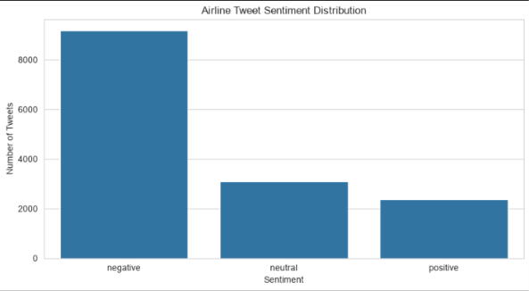

**Conclusion:** Negative tweets form the largest sentiment group, showing that many customers shared unfavourable airline experiences. This class imbalance makes macro-averaged evaluation metrics important.

### Airline-wise Negative Sentiment Share
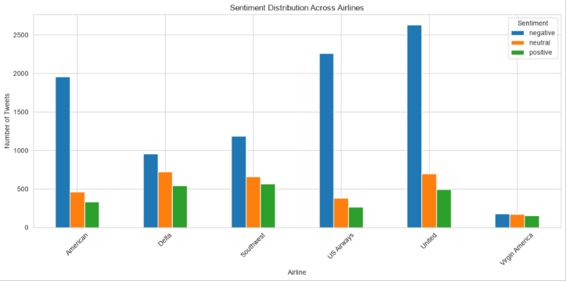

**Conclusion:** This graph compares the proportion of negative feedback received by each airline. Differences between airlines can help identify where customer experience improvements may be needed.

###  Average Tweet Length by Sentiment
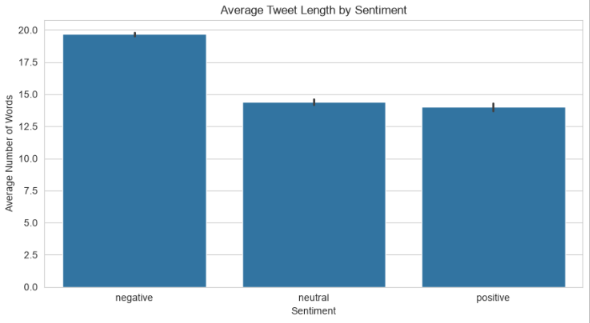

**Conclusion:** Average tweet length compares how much customers write when expressing different sentiments. Tweet length alone does not determine sentiment, but it helps describe differences in customer feedback.

### Negative Word Frequency
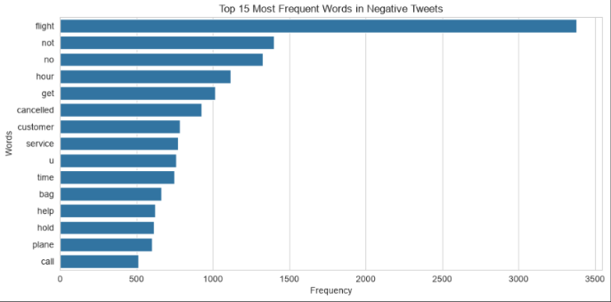

**Conclusion:** Frequent negative words highlight recurring language in dissatisfied customer feedback. These terms can help identify common concerns and support further complaint analysis.

###  Positive Word Frequency
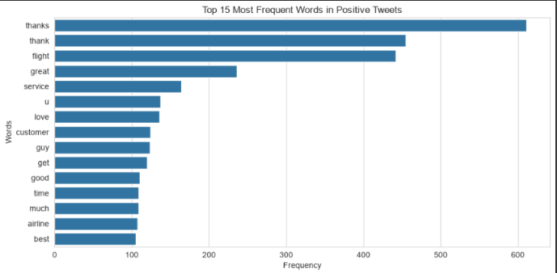

**Conclusion:** Frequent positive words reveal the vocabulary customers use when describing satisfactory experiences. Comparing positive and negative word patterns helps distinguish language associated with different sentiments.


------------------------------------------------------------------------

## Step 2 --- Feature Extraction: Bag of Words, TF-IDF and N-Grams

### Objective

Convert cleaned airline tweets into numerical representations that
machine learning algorithms can process.

### Workflow

1.  Create a small example corpus to understand document-term matrices.
2.  Apply `CountVectorizer` to generate Bag-of-Words features.
3.  Apply `TfidfVectorizer` to calculate word importance.
4.  Generate unigrams and bigrams using N-Grams.
5.  Apply BoW and TF-IDF to the cleaned airline tweet dataset.
6.  Calculate feature-matrix sparsity.
7.  Identify words with high average TF-IDF scores.
8.  Find frequent bigrams in negative tweets.
9.  Compare the feature extraction methods.

### Recorded Results

  Feature Method     Number of Features   Sparsity
  ---------------- -------------------- ----------
  Bag of Words                    3,000     99.74%
  TF-IDF                          3,000     99.74%

**Top recorded TF-IDF terms:** `flight`, `thanks`, `not`, `no`, `get`,
`hour`, `thank`, `cancelled`, `service`, and `customer`.

**Most frequent negative bigram:** `customer service` with **457
occurrences**.

### Key Learning

Bag of Words represents word occurrence, while TF-IDF gives more weight
to terms that are informative within a document. N-Grams preserve short
word combinations and can capture expressions such as `customer service`
and `late flight`.

###  TF-IDF Feature Matrix
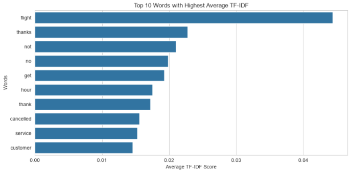

**Conclusion:** The TF-IDF matrix converts tweet text into numerical features based on term importance. Its sparse structure is typical of text data, where each tweet contains only a small portion of the full vocabulary.

###  Top Negative Bigrams
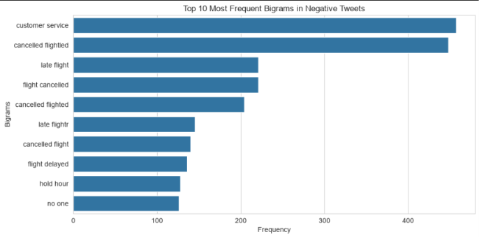

**Conclusion:** Negative bigrams show word combinations that frequently occur in dissatisfied customer tweets. These combinations provide more context than individual words alone.
------------------------------------------------------------------------

## Step 3 --- Word Embeddings: Word2Vec (CBOW and Skip-gram)

### Objective

Learn dense word-vector representations and explore semantic
relationships between words in airline tweets.

### Workflow

1.  Tokenise the cleaned tweets.
2.  Calculate average tokens per tweet and unique-word statistics.
3.  Train a CBOW Word2Vec model.
4.  Train a Skip-gram Word2Vec model.
5.  Compare vocabulary and vector representations.
6.  Find similar words using the trained embeddings.
7.  Compare word similarities between CBOW and Skip-gram.
8.  Reduce word-vector dimensions using PCA.
9.  Visualise selected word embeddings.
10. Save and reload the trained Word2Vec model.

### Model Configuration

  Setting                      Value
  -------------------------- -------
  Vector size                    100
  Window                           5
  Minimum word count               3
  Epochs                          15
  CBOW setting (`sg`)              0
  Skip-gram setting (`sg`)         1
  Random seed                     42

The notebook saves the Skip-gram model as `word2vec_skipgram.model` and
the PCA visualisation as `Word2Vec_PCA_Visualization.png`.

### Key Learning

CBOW predicts a target word from its surrounding context, while
Skip-gram predicts surrounding words from a target word. Word2Vec
creates dense vector representations that can capture semantic
relationships beyond simple word counts.

### Word2Vec PCA Visualisation
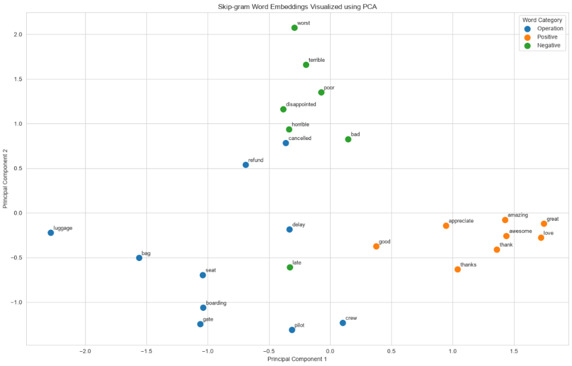

**Conclusion:** PCA projects high-dimensional Word2Vec embeddings into two dimensions so selected word relationships can be inspected visually. Nearby words may have similar learned context representations, although this is only a two-dimensional approximation.

------------------------------------------------------------------------

## Step 4 --- Text Classification Pipeline: Three-Class Sentiment Analysis

### Objective

Train and evaluate machine learning models to classify airline tweets as
negative, neutral, or positive.

### Workflow

1.  Select the cleaned tweet text and sentiment labels.
2.  Encode sentiment labels.
3.  Split the data into training and testing sets using an 80/20
    stratified split.
4.  Create a majority-class baseline.
5.  Train four classifiers:
    -   Logistic Regression with Bag of Words.
    -   Logistic Regression with TF-IDF.
    -   Logistic Regression with TF-IDF Unigrams and Bigrams.
    -   Logistic Regression using averaged Word2Vec vectors.
6.  Compare accuracy, macro precision, macro recall, and macro F1-score.
7.  Inspect the best model and its classification results.
8.  Analyse important positive and negative features.
9.  Inspect incorrectly classified tweets.
10. Save the selected TF-IDF pipeline using Joblib.

### Recorded Model Comparison

  -----------------------------------------------------------------------
  Model             Accuracy          Macro   Macro Recall       Macro F1
                                  Precision                
  ----------- -------------- -------------- -------------- --------------
  **TF-IDF        **0.7647**     **0.7041**     **0.7351**     **0.7164**
  N-Grams**                                                

  TF-IDF              0.7538         0.6955         0.7334         0.7090

  Bag of              0.7479         0.6880         0.7297         0.7027
  Words                                                    

  Averaged            0.7096         0.6455         0.6824         0.6583
  Word2Vec                                                 
  -----------------------------------------------------------------------

**Best recorded model:** Logistic Regression with TF-IDF Unigrams and
Bigrams.

**Saved model:** `sentiment_pipeline.pkl`

### Evaluation Note

The notebook's majority-baseline output is **0.0000**, caused by
comparing encoded integer labels with the string `"negative"`. This is
not a valid baseline result. Recalculate the baseline using the encoded
majority class before publishing the final comparison.

The classification-report cell also contains a label-format mismatch.
Use the encoded class labels consistently or inverse-transform both
actual and predicted labels before generating the report.

### Key Learning

Accuracy alone does not show how well a model performs across all
sentiment classes. Macro precision, macro recall, and macro F1 provide a
more balanced view, especially when negative, neutral, and positive
tweets are unevenly distributed.

###  Model Comparison
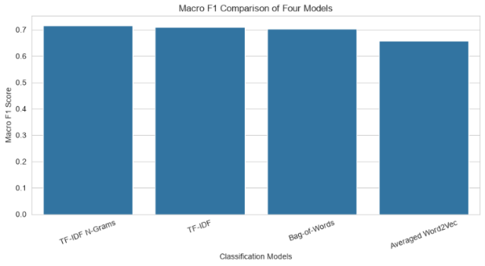

**Conclusion:** This graph compares the classification performance of the tested models. In the recorded results, TF-IDF with unigrams and bigrams achieved the highest macro F1-score among the four feature approaches.

### Sentiment Approach Comparison
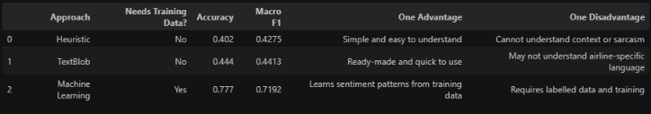

**Conclusion:** The graph compares heuristic, TextBlob, and machine learning approaches on the same evaluation sample. The recorded machine learning results achieved the strongest overall performance, showing the value of training on domain-specific labelled tweets.

------------------------------------------------------------------------

## Step 5 --- Sentiment Analysis Approaches and POS Tagging

### Objective

Compare a manually defined rule-based approach, a ready-made sentiment
tool, and the trained machine learning pipeline. Use POS tagging to
inspect common complaint-related words.

### Workflow

1.  Select the same 1,000 test tweets for comparison.
2.  Create positive and negative word lists for a heuristic sentiment
    method.
3.  Calculate sentiment using a custom rule-based function.
4.  Apply TextBlob polarity scoring.
5.  Load the saved machine learning pipeline and predict sentiment.
6.  Compare accuracy and macro F1 across all three approaches.
7.  Compare class-wise recall.
8.  Perform POS tagging on five example airline tweets.
9.  Select 500 negative tweets and extract nouns using NLTK.
10. Compare frequent nouns with the dataset's `negativereason` field.

### Recorded Approach Comparison

  Approach                   Accuracy     Macro F1
  ---------------------- ------------ ------------
  Heuristic                    0.4020       0.4275
  TextBlob                     0.4440       0.4413
  **Machine Learning**     **0.7770**   **0.7192**

### Class-Wise Recall

  Approach             Neutral Recall   Negative Recall   Positive Recall
  ------------------ ---------------- ----------------- -----------------
  Heuristic                    0.8009            0.2426            0.5200
  TextBlob                     0.6256            0.3224            0.7067
  Machine Learning             0.6777        **0.8279**            0.7000

### POS Tagging Findings

The top recorded nouns in 500 negative tweets included:

  Word         Frequency
  ---------- -----------
  flight             136
  bag                 35
  service             32
  flights             30
  time                27
  customer            26
  amp                 24
  help                24
  plane               22

**Top recorded negative reasons:**

  Negative Reason             Count
  ------------------------- -------
  Customer Service Issue        155
  Can't Tell                     75
  Late Flight                    54
  Lost Luggage                   52
  Flight Booking Problems        44

### Key Learning

The machine learning approach performed best on the recorded evaluation
sample because it learned patterns from labelled airline tweets.
Heuristic methods are simple and interpretable, while TextBlob is
convenient for quick general-purpose sentiment analysis. POS tagging
helped identify recurring topics in negative customer feedback. 

### Top 10 Nouns in Negative Tweets
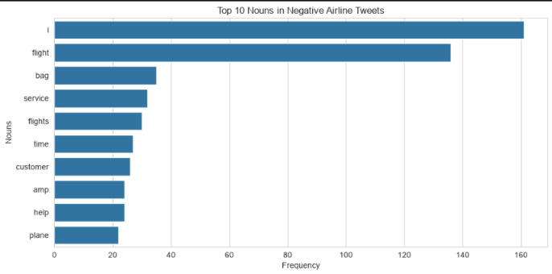

**Conclusion:** Frequent nouns help reveal topics that appear repeatedly in negative customer feedback. These terms provide clues about complaint themes, although frequency alone does not explain the full reason behind each complaint.

------------------------------------------------------------------------

## Step 6 --- Streamlit Airline Sentiment Analysis Application

### Objective

Build an interactive application that uses the saved machine learning
pipeline to analyse new airline tweets.

### Main Features

-   Enter a customer tweet or select a sample tweet.
-   Predict Negative, Neutral, or Positive sentiment.
-   Display sentiment probability scores.
-   Show tweet word count.
-   Extract and display `@mentions` and hashtags.
-   Expand POS tagging results to view words, POS tags, and tag
    meanings.
-   Extract nouns from the entered tweet.
-   Display the original tweet and predicted sentiment in a
    user-friendly interface.

### Main Application Files

-   `app.py` --- Streamlit application.
-   `text_preprocessing.py` --- text-cleaning function.
-   `sentiment_pipeline.pkl` --- saved TF-IDF and Logistic Regression
    pipeline.

### Run the Application

``` bash
streamlit run app.py
```

Open the local address shown in the terminal, usually:

``` text
http://localhost:8501
```

**Live application URL:** Add your Streamlit Community Cloud URL here
after deployment.

### Streamlit App Start Window
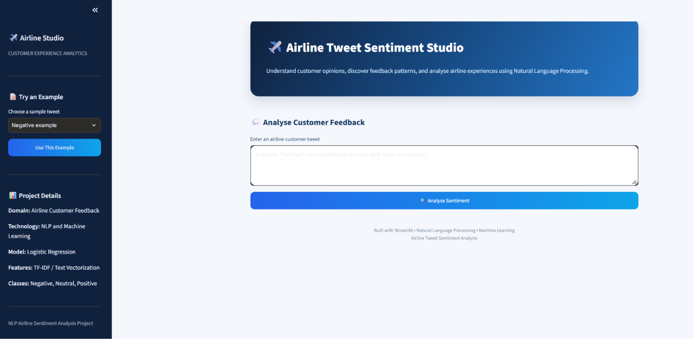

**Conclusion:** This screenshot shows the starting interface of the airline sentiment analysis application. It demonstrates how the trained NLP pipeline is made accessible through a user-friendly interface.
------------------------------------------------------------------------

## 📊 Overall Results Summary

  -----------------------------------------------------------------------
  Step                                Main Result
  ----------------------------------- -----------------------------------
  Step 1 --- Preprocessing            14,640 tweets explored; 62.69% were
                                      negative

  Step 2 --- Feature Extraction       BoW and TF-IDF each produced 3,000
                                      features with 99.74% sparsity

  Step 3 --- Word2Vec                 CBOW and Skip-gram models trained
                                      with 100-dimensional vectors

  Step 4 --- Classification           TF-IDF N-Grams achieved 0.7647
                                      accuracy and 0.7164 macro F1

  Step 5 --- Approach Comparison      ML achieved 0.7770 accuracy and
                                      0.7192 macro F1 on 1,000 test
                                      tweets

  Step 6 --- Streamlit                Interactive sentiment prediction
                                      and POS tagging application created
  -----------------------------------------------------------------------


------------------------------------------------------------------------

## 🧰 Technologies Used

-   **Python** --- programming language
-   **Jupyter Notebook** --- interactive practical environment
-   **Pandas / NumPy** --- data handling and numerical operations
-   **Matplotlib / Seaborn** --- charts and visualisations
-   **Regular Expressions** --- text pattern extraction and cleaning
-   **NLTK** --- tokenization, stop words, lemmatization, and POS
    tagging
-   **Scikit-learn** --- vectorization, Logistic Regression, splitting,
    and evaluation
-   **Gensim** --- CBOW and Skip-gram Word2Vec
-   **TextBlob** --- ready-made sentiment analysis
-   **Joblib** --- model saving and loading
-   **Streamlit** --- interactive web application

## ⚙️ Installation and Usage

### 1. Create a virtual environment (recommended)

``` bash
python -m venv .venv
```

On Windows:

``` bash
.venv\Scripts\activate
```

### 2. Install the main dependencies

``` bash
python -m pip install --upgrade pip
pip install pandas numpy matplotlib seaborn scikit-learn gensim nltk textblob joblib streamlit
```

### 3. Download NLTK resources

Run the following in a notebook cell or Python session:

``` python
import nltk

nltk.download("punkt")
nltk.download("punkt_tab")
nltk.download("stopwords")
nltk.download("wordnet")
nltk.download("averaged_perceptron_tagger_eng")
```

### 4. Run the notebook

Open `NLP_Practical_Exam_SetB.ipynb` in Jupyter Notebook, JupyterLab, or
VS Code. Select the correct Python kernel and run cells from top to
bottom.

Make sure `Tweets.csv` is available at the path used in the notebook.

### 5. Run the Streamlit application

Keep the following files together in the application folder:

``` text
app.py
text_preprocessing.py
sentiment_pipeline.pkl
```

Then run:

``` bash
streamlit run app.py
```

The saved pipeline and preprocessing function must use compatible
text-cleaning logic. The application should apply the same preprocessing
used during model training.

------------------------------------------------------------------------


This is a suggested structure. Include only files that actually exist in
your repository. Avoid committing large datasets or model files if they
exceed repository limits; use Git LFS or another suitable storage option
when needed.

## 🔍 Key Learnings

1.  **Text preprocessing:** Cleaning social media text improves
    consistency and prepares it for feature extraction.
2.  **Feature extraction:** BoW, TF-IDF, and N-Grams represent text in
    numerical form, while Word2Vec learns dense word representations.
3.  **Classification:** Comparing models with macro F1 helps evaluate
    performance across imbalanced sentiment classes.
4.  **Sentiment approaches:** Domain-trained machine learning can
    outperform general-purpose or manually defined methods on
    domain-specific data.
5.  **POS tagging:** Noun extraction helps identify recurring topics in
    customer complaints.
6.  **Deployment:** Streamlit connects a trained NLP pipeline to an
    interactive application.

## ⚠️ Limitations and Future Improvements

-   The dataset contains historical airline tweets and may not represent
    current customer language.
-   The sentiment classes are imbalanced, so accuracy should not be used
    alone.
-   Sarcasm, short messages, spelling variations, and Hinglish can be
    difficult to classify.
-   The heuristic and TextBlob methods may not understand
    airline-specific context.
-   The majority-baseline and classification-report cells in Step 4
    should be corrected before final submission.
-   Add more recent and diverse airline feedback.
-   Experiment with pretrained Transformer models such as DistilBERT.
-   Improve multilingual and Hinglish text processing.
-   Record package versions and add verified screenshots for
    reproducibility.
-   Evaluate the Streamlit application with additional unseen tweets.

## ✅ Final Conclusion

This project demonstrates a complete Natural Language Processing
workflow for airline customer sentiment analysis. It begins with dataset
exploration, RegEx, and text preprocessing, then moves through BoW,
TF-IDF, N-Grams, and Word2Vec feature representations. Multiple
classification and sentiment approaches are evaluated, and POS tagging
is used to explore common complaint topics. Finally, the saved machine
learning pipeline is integrated into a Streamlit application so that
users can analyse new airline tweets interactively.

The recorded experiments show that **TF-IDF with Unigrams and Bigrams
combined with Logistic Regression** achieved the strongest Step 4 macro
F1-score among the four tested classifiers. The project provides
practical experience in text analytics, machine learning evaluation, NLP
techniques, and application development.

------------------------------------------------------------------------

<div align="center">

# 👨‍💻 Author

## Santosh Verma

### Data Analyst · AI/ML Developer

### Project notes

**Tools:** Python · Pandas · NumPy · Scikit-learn · Matplotlib · Seaborn · Jupyter · NLTK ·

**Before publishing:**Made for learning, experimentation, and practical understanding of Natural Language Processing.

</div>


